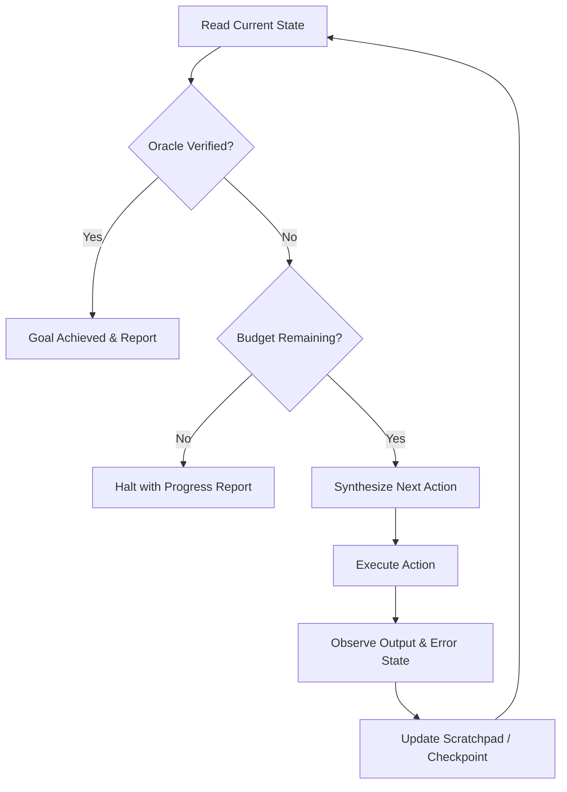

# Goal: Autonomous Long-Running Execution Loop Pattern

## Intent
Execute an ambitious, multi-step engineering objective end-to-end without stopping for hand-holding, continuously planning, executing, evaluating, and self-correcting until an unambiguous empirical verification condition is satisfied.

## Theoretical Foundation
Rooted in the **ReAct (Reason + Act)** framework (Yao et al., 2022) and **AWS Prescriptive Guidance: Agentic Loops & Deterministic Overrides**. Autonomous execution requires three non-negotiable guardrails:
1. An objective **Verification Oracle** (the definition of done).
2. A strict **Step Budget** to prevent infinite loops and runaway token usage.
3. Persistent **State Checkpoints** to enable recovery from dead ends.

## Operational Workflow

### Step 1: Goal Formalization & Oracle Definition
Define the objective using three strict parameters:
1. **Objective Statement**: Unambiguous description of the target state.
2. **Verification Oracle**: The exact command or programmatic check that returns exit code 0 when, and only when, the goal is fully accomplished (e.g. `npm run test:e2e && npm run build`).
3. **Step Budget**: Maximum number of tool iterations / cycles (default: 25).

### Step 2: The Agentic Execution Loop
Repeat the following cycle until completion or budget exhaustion:

### Step 3: Self-Correction Protocol
- If a command fails or a test is broken, do NOT retry the identical action.
- Analyze the error trace, form a new hypothesis, make an adjusting edit, and re-test.
- If two consecutive attempts fail the same way, backtrack to the last known working git commit:
  \`\`\`bash
  git checkout <last-working-checkpoint>
  \`\`\`

### Step 4: Completion Criteria
The loop terminates successfully ONLY when the Verification Oracle command executes cleanly with exit code 0 and passes all regression checks. Provide a summary artifact detailing all changes made and test outputs.

---

## Citations & Provenance
1. **ReAct Paradigm**: Yao, S., Zhao, J., Yu, D., Du, N., Shafran, I., Narasimhan, K., & Cao, Y. (2022). *ReAct: Synergizing Reasoning and Acting in Language Models*. International Conference on Learning Representations (ICLR 2023). arXiv:2210.03629.
2. **AWS Agentic Guidance**: Amazon Web Services Architecture Team (2024). *Agentic Design Patterns: Deterministic Overrides, Loop Budgets, and Termination Conditions*. AWS Prescriptive Guidance.
3. **SWE-bench Benchmark**: Jimenez, C. E., et al. (2024). *SWE-bench: Can Language Models Resolve Real-World GitHub Issues?*. ICLR 2024. arXiv:2310.06770.

