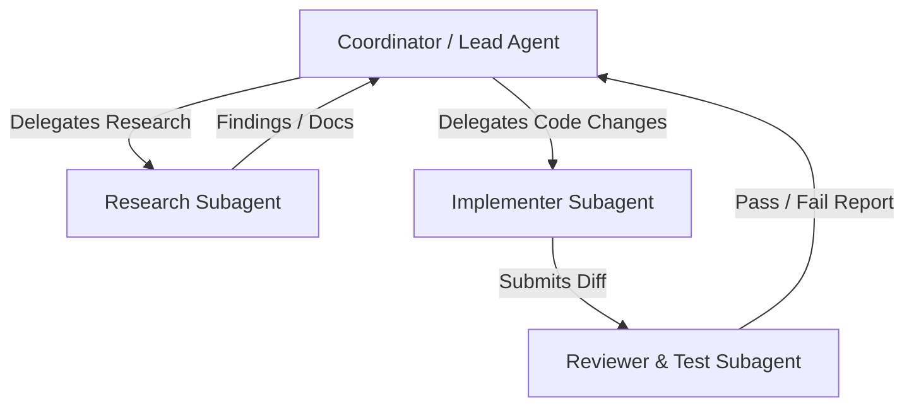

# Teamwork: Hierarchical Multi-Agent Orchestration Pattern

## Intent
Decompose a large, multifaceted engineering challenge into specialized subtasks assigned to isolated subagents, coordinating their workflows, inputs, outputs, and quality gates to prevent context pollution and accelerate delivery.

## Theoretical Foundation
Rooted in the **Coordinator-Subagent Hierarchy** (AWS Agentic Patterns, Manning *Designing AI Agents*), Concurrency Control, and Message Passing Concurrency (Actor Model). Context bloat is the primary cause of agent degradation; delegating bounded subtasks to fresh contexts preserves high attention fidelity.

## Team Topology & Roles

### 1. The Coordinator (Parent Session)
- Holds the master plan, DAG of tickets, and shared state.
- Spawns subagents with specific, non-overlapping briefs.
- Synthesizes findings, manages merge conflicts, and maintains communication with the user.

### 2. The Researcher (Read-Only Subagent)
- Operates in read-only mode to explore the codebase, search web docs, and trace call graphs.
- Delivers a structured brief containing file paths, relevant symbols, and code snippets back to the Coordinator.
- Never writes or edits code directly.

### 3. The Implementer (Worker Subagent)
- Receives a single atomic ticket and the Researcher's brief.
- Implements tests and code changes strictly within assigned file boundaries.
- Delivers git status, modified file paths, and test logs to the Coordinator.

### 4. The Reviewer (Verification Subagent)
- Runs an independent adversarial review and executes the full regression test suite.
- Audits for regressions, security vulnerabilities, and adherence to specifications.
- Returns an actionable verdict: `APPROVED` or `REJECTED` with exact remediation instructions.

## Operational Workflow

### Step 1: Task Contract Definition
Before launching any subagent, the Coordinator writes an unambiguous task brief:
- **Role & Capability Scope**
- **Explicit Inputs**: Specification, target files, acceptance criteria.
- **Expected Return Artifact**: Expected format, JSON/Markdown structure.

### Step 2: Handoff & Asynchronous Execution
- Launch subagent(s) using native harness subagent capabilities (e.g. `invoke_subagent` in AGY, custom subagents in Claude Code or Roo).
- Avoid busy polling; await completion callbacks or messages.

### Step 3: Conflict Resolution & Integration
- Inspect outputs from completed subagents.
- Ensure no out-of-bounds files were touched.
- Run project-wide integration tests before confirming completion.

---

## Citations & Provenance
1. **Coordinator-Subagent Hierarchies**: Amazon Web Services Architecture Team (2024). *Agentic Design Patterns: Hierarchical Delegation and Context Boundaries*. AWS Whitepaper.
2. **Actor Model of Computation**: Hewitt, C., Bishop, P., & Steiger, R. (1973). *A Universal Modular ACTOR Formalism for Artificial Intelligence*. IJCAI'73.
3. **Designing AI Agents**: Huang, J. (2024). *Designing AI Agents: Multi-Agent Collaboration and Task Swarms*. Manning Publications.
4. **Antigravity Multi-Agent Protocol**: Google DeepMind (2024). *Subagent Lifecycle, Shared Workspaces, and Reactive Wakeup Protocol*.

