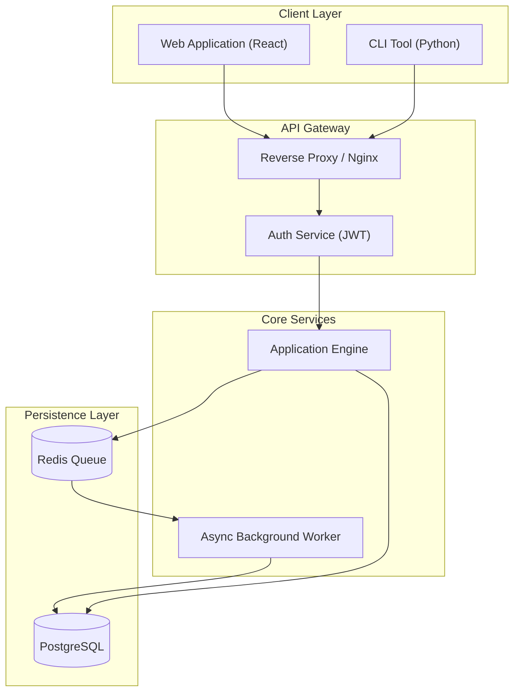
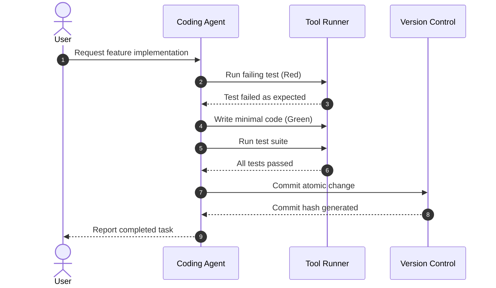
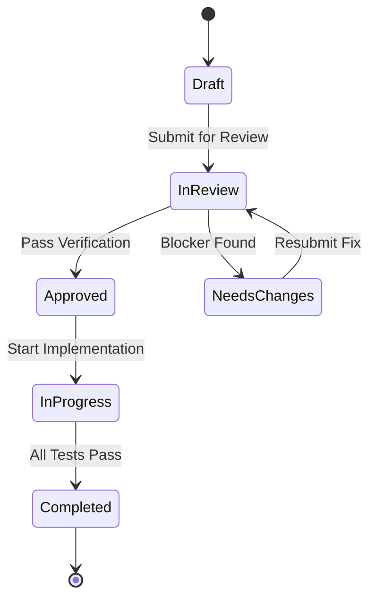
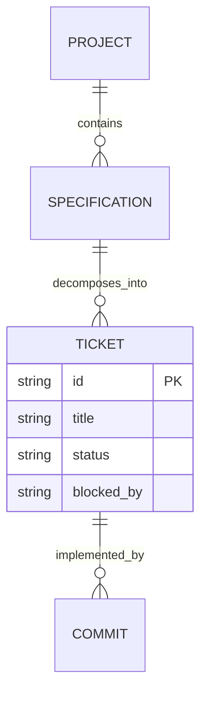

# /visualize - Architecture and flow visualization pattern. Generates standardized, syntactically valid Mermaid and C4 diagrams for system designs, data flows, and state machines.

Run the following workflow instructions for the provided input: $ARGUMENTS

# Visualize: Architecture & Flow Visualization Pattern

## Intent
Transform textual architectures, complex algorithms, multi-agent interactions, and data models into unambiguous visual diagrams using standard Mermaid syntax.

## Theoretical Foundation
Rooted in cognitive load theory and the **C4 Model for Software Architecture** (Brown, 2018). Visual models ground abstract system descriptions, making boundaries, data flows, and state transitions instantly verifiable by humans and agents alike.

## Standard Diagram Archetypes

### 1. Component & Boundary Architecture (C4 Container / Component)
Use `flowchart TD` or `flowchart LR` with subgraphs to depict architectural layers:

### 2. Request / Response & Protocol Flow (Sequence Diagram)
Use `sequenceDiagram` with activation lifelines to show chronological interactions:

### 3. State Machines & Lifecycles (State Diagram)
Use `stateDiagram-v2` for entity states, task statuses, or connection lifecycles:

### 4. Data Models & Relationships (Entity-Relationship Diagram)
Use `erDiagram` for relational schemas and domain models:

## Mermaid Syntax Safety Rules
1. **Always Quote Node Labels with Special Characters**:
   - `id["Label (Extra Info)"]` instead of `id[Label (Extra Info)]`.
2. **Supported Diagram Types Only**:
   - Flowcharts (`flowchart TD`), Sequence (`sequenceDiagram`), State (`stateDiagram-v2`), Class (`classDiagram`), ER (`erDiagram`).
3. **Avoid Raw HTML in Node Text**: Use pure Markdown or clean text inside node strings.

---

## Citations & Provenance
1. **The C4 Model for Software Architecture**: Brown, S. (2018). *Software Architecture for Developers: Visualise, document and explore your software architecture*. Leanpub.
2. **Mermaid Graphing Standard**: Sveidqvist, K., et al. (2014-2026). *Mermaid: Markdown-inspired syntax for generating charts and diagrams* (https://mermaid.js.org/).
3. **Cognitive Load Theory in Software Visualization**: Sweller, J. (2011). *Cognitive Load Theory*. Psychology of Learning and Motivation, Vol. 55.
