# Agentic Coding Design Patterns & Skills

[](LICENSE)
[-success.svg)]()
[]()

An open, cross-harness repository of **best practices, architectural design patterns, and executable skills** for AI coding agents. Grounded in peer-reviewed literature and production-grade architectures from leading AI engineering labs (Anthropic, Google DeepMind, AWS Prescriptive Guidance, Princeton, UC Berkeley).

Designed to be canonical, portable, and ready to sync into **any** agent harness.

---

## 🌟 Supported Agent Harnesses

| Harness | Configuration Files Generated | Skill / Command Format |
| :--- | :--- | :--- |
| **Claude Code** | `.claude/commands/*.md`, `CLAUDE.md` | Slash commands with `$ARGUMENTS` interpolation |
| **Antigravity (AGY)** | `.agents/skills/<name>/SKILL.md`, `GEMINI.md` | Native skill bundles with YAML frontmatter |
| **Cursor** | `.cursor/rules/*.mdc`, `.cursorrules` | MDC rule system with glob filters |
| **Roo Code & Cline** | `.clinerules`, `.roomodes` | Custom modes and operational instructions |
| **Windsurf** | `.windsurfrules` | Cascade contextual memory rules |
| **GitHub Copilot** | `.github/copilot-instructions.md` | Standard instructions guide |
| **Universal / Aider** | `AGENTS.md` | Repository-wide agent conventions |

---

## 🧭 The 13 Core Agentic Patterns & Commands

```mermaid
flowchart LR
    subgraph Discovery["1. Discovery & Design"]
        direction TB
        G["/grill-me<br/><i>(Socratic Elicitation)</i>"]
        GD["/grill-me-with-docs<br/><i>(Grounded Inquiry)</i>"]
        S["/to-spec<br/><i>(RFC 2119 PRD)</i>"]
        T["/to-tickets<br/><i>(DAG Decomposition)</i>"]
        CW["/clear-writing<br/><i>(Empirical Clarity)</i>"]
    end

    subgraph Execution["2. Execution & Quality"]
        direction TB
        I["/implement<br/><i>(TDD Red-Green)</i>"]
        SC["/self-critic<br/><i>(Verbal Reflexion)</i>"]
        CR["/code-review<br/><i>(Adversarial Audit)</i>"]
    end

    subgraph Meta["3. Autonomous & Meta Loops"]
        direction TB
        GL["/goal<br/><i>(Autonomous ReAct)</i>"]
        B["/boost<br/><i>(Tree-of-Thoughts)</i>"]
        TW["/teamwork<br/><i>(Subagent Swarm)</i>"]
        SL["/schedule-loop<br/><i>(Reconciliation Loop)</i>"]
        RL["/retro-learn<br/><i>(Rule Distillation)</i>"]
        V["/visualize<br/><i>(Mermaid Modeling)</i>"]
    end

    Discovery --> Execution --> Meta
```



| Command | Category | Purpose | Theoretical & Industry Basis |
| :--- | :--- | :--- | :--- |
| **`/clear-writing`** | Communication | Fluff-free technical explanations & builder writeups (ASD-STE100 + Karpathy style). | ASD-STE100 Issue 9; Karpathy Builder Ethos |
| **`/grill-me`** | Discovery | Interactive requirements interview; walks down the design tree resolving decisions one-by-one. | Socratic Method; Domain-Driven Design (Evans) |
| **`/grill-me-with-docs`** | Discovery | Pre-retrieves official library documentation before asking technical architecture questions. | Retrieval-Augmented Generation (Lewis et al.) |
| **`/to-spec`** | Discovery | Converts requirements and transcripts into an RFC-grade specification with strict boundaries. | RFC 2119 (Bradner); Amazon PR/FAQ; ADR (Nygard) |
| **`/to-tickets`** | Discovery | Breaks specifications into an ordered Directed Acyclic Graph (DAG) of atomic, verifiable tickets. | Work Breakdown Structure; BDD (North); Kahn DAG |
| **`/implement`** | Execution | Executes tickets using Test-Driven Development (Red-Green-Refactor) and atomic git commits. | Test-Driven Development (Beck); Fowler Refactoring |
| **`/self-critic`** | Quality | Pre-execution internal audit checking for hallucinations, broken invariants, and boundary conditions. | Reflexion (Shinn et al., NeurIPS 2023); Self-Refine |
| **`/code-review`** | Quality | Senior staff adversarial code review evaluating correctness, security, concurrency, and performance. | Fagan Inspection; Google Code Review Practices; OWASP |
| **`/retro-learn`** | Memory | Distills post-session corrections and error recoveries into permanent, concise harness rules. | Voyager Skill Library (Wang et al.); MemGPT (Packer) |
| **`/goal`** | Autonomy | Autonomous long-running execution loop bounded by an empirical verification oracle and step budget. | ReAct (Yao et al., ICLR 2023); AWS Agentic Loops |
| **`/boost`** | Deliberation | Multi-perspective debate (Architect, Security Auditor, SRE, Hacker) using Tree-of-Thoughts. | Tree of Thoughts (Yao et al., NeurIPS 2023) |
| **`/teamwork`** | Multi-Agent | Coordinates isolated subagents (Researcher, Implementer, Reviewer) to prevent context contamination. | Actor Model (Hewitt); AWS Coordinator-Subagent Hierarchy |
| **`/schedule-loop`** | Maintenance | Idempotent recurring loop for health checks, drift remediation, and dependency monitoring. | Kubernetes Reconciliation Loop (Burns) |
| **`/visualize`** | Modeling | Generates standard Mermaid diagrams (C4 component, sequence, state machine, ER diagrams). | C4 Model (Brown); Mermaid Specification |

---

## 🚀 Quick Start & Installation

### Option 1: Install into Any Target Repository (Zero Install)
You can sync these patterns directly into any existing repository using Python (standard library only, zero external packages):

```bash
# Sync into current project for all harnesses
python3 /path/to/agentic-coding-design-patterns/cli/sync.py

# Or sync to specific harnesses (e.g. Claude Code and Cursor only)
python3 /path/to/agentic-coding-design-patterns/cli/sync.py --target claude,cursor --output-dir /path/to/your/project

# Or use the bash wrapper
./install.sh --target antigravity,claude --output-dir ~/projects/my-app
```

### Option 2: List Available Patterns
```bash
python3 cli/sync.py --list
```

---

## 📂 Repository Layout

```
agentic-coding-design-patterns/
├── skills/                     # Canonical single source of truth for all skills
│   ├── grill-me/SKILL.md
│   ├── grill-me-with-docs/SKILL.md
│   ├── to-spec/SKILL.md
│   ├── to-tickets/SKILL.md
│   ├── implement/SKILL.md
│   ├── code-review/SKILL.md
│   ├── retro-learn/SKILL.md
│   ├── goal/SKILL.md
│   ├── boost/SKILL.md
│   ├── teamwork/SKILL.md
│   ├── schedule-loop/SKILL.md
│   ├── self-critic/SKILL.md
│   └── visualize/SKILL.md
├── templates/                  # Reusable engineering templates
│   ├── prd_spec_template.md    # RFC 2119 PRD / Spec template
│   ├── ticket_template.md      # DAG task decomposition template
│   ├── code_review_template.md # Multi-lens review rubric
│   └── adr_template.md         # Architecture Decision Record
├── docs/                       # In-depth architectural documentation & citations
│   ├── agentic_design_patterns.md
│   └── harness_matrix.md
├── cli/                        # Zero-dependency Python sync compiler
│   ├── sync.py
│   └── __main__.py
├── install.sh                  # Shell installer wrapper
└── README.md
```

---

## 📚 Academic & Industry Citations
- **Yao, S., et al. (2022)**. *ReAct: Synergizing Reasoning and Acting in Language Models*. ICLR 2023.
- **Shinn, N., et al. (2023)**. *Reflexion: Language Agents with Verbal Reinforcement Learning*. NeurIPS 2023.
- **Yao, S., et al. (2023)**. *Tree of Thoughts: Deliberate Problem Solving with Large Language Models*. NeurIPS 2023.
- **Wang, G., et al. (2023)**. *Voyager: An Open-Ended Embodied Agent with Large Language Models*. arXiv:2305.16291.
- **Packer, C., et al. (2023)**. *MemGPT: Towards LLMs as Operating Systems*. arXiv:2310.08560.
- **Amazon Web Services (2024)**. *Agentic Design Patterns - Prescriptive Guidance*. AWS Architecture Series.
- **Huang, J. (2024)**. *Designing AI Agents*. Manning Publications.
- **Beck, K. (2002)**. *Test-Driven Development: By Example*. Addison-Wesley.
- **Fagan, M. E. (1976)**. *Design and code inspections to reduce errors in program development*. IBM Systems Journal.
- **Bradner, S. (1997)**. *Key words for use in RFCs to Indicate Requirement Levels*. RFC 2119.

---

## 📄 License
Released under the [MIT License](LICENSE).
