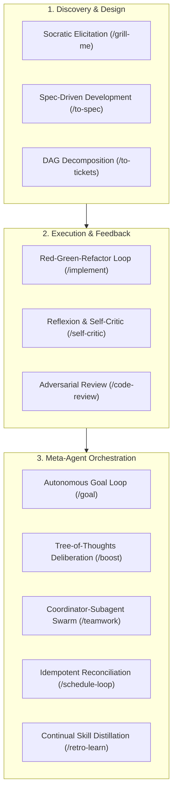

# Architectural Design Patterns for Agentic Software Engineering

This document synthesizes core design patterns for autonomous and human-in-the-loop coding agents. These patterns are grounded in peer-reviewed literature and production-grade architectures from leading AI engineering laboratories (Anthropic, Google DeepMind, AWS, Princeton, UC Berkeley).

---

## 1. The Core Problem: Agent Degradation in Software Engineering
Unstructured LLM coding workflows routinely suffer from:
1. **Context Window Contamination**: Accumulating noise, test failure logs, and raw diffs until attention fidelity collapses.
2. **Error Compounding**: Minor initial misassumptions that propagate into massive broken refactors.
3. **Forward-Generation Bias**: Generating plausible-looking solutions without verifying edge cases or domain invariants.
4. **Premature Convergence**: Jumping straight to code edits before requirements and boundaries are established.

Agentic coding design patterns solve these failure modes by enforcing **structural guardrails**, **feedback loops**, and **cognitive boundaries**.

---

## 2. Taxonomy of Agentic Design Patterns

---

## 3. Detailed Pattern Specifications

### Pattern A: Socratic Requirements Elicitation (`/grill-me`, `/grill-me-with-docs`)
- **Academic / Industry Basis**: Socratic Dialogue; Domain-Driven Design (Evans, 2003); Retrieval-Augmented Generation (Lewis et al., 2020).
- **Core Mechanism**: Before modifying code, the agent conducts a structured interview with the developer. It traverses the architectural decision tree top-down, asking questions strictly one at a time, providing concrete options with a recommended default, and grounding options in official documentation.
- **Why it Matters**: Eliminates late-stage refactors by locking down interfaces and boundaries upfront.

### Pattern B: Spec-Driven Development & RFC Contracts (`/to-spec`)
- **Academic / Industry Basis**: RFC 2119 Normative Keywords (Bradner, 1997); Amazon PR/FAQ Process; Architecture Decision Records (Nygard, 2011).
- **Core Mechanism**: Converts unstructured thoughts or interview transcripts into an authoritative specification. Mandates explicit sections: Problem Statement, Goals vs. Non-Goals, Normative Requirements (`MUST`, `SHOULD`, `MAY`), Component Diagram, Schema Contracts, and Rollback Procedures.
- **Why it Matters**: Creates an immutable contract that serves as the objective source of truth for both implementation and review.

### Pattern C: Directed Acyclic Graph (DAG) Task Decomposition (`/to-tickets`)
- **Academic / Industry Basis**: Work Breakdown Structures (WBS); Kahn's Algorithm for Topological Sorting; Behavior-Driven Development (North, 2006).
- **Core Mechanism**: Decomposes a specification into atomic, isolated tickets. Each ticket declares upstream dependencies (`blocked_by`), file boundaries, Gherkin acceptance criteria (Given/When/Then), and a deterministic automated verification command.
- **Why it Matters**: Isolates agent attention to a single verifiable subtask, preventing context saturation and cognitive overload.

### Pattern D: Test-Driven Development & Atomic Verification Gate (`/implement`)
- **Academic / Industry Basis**: Test-Driven Development by Example (Beck, 2002); Refactoring (Fowler, 1999); Conventional Commits 1.0.0.
- **Core Mechanism**: Strict Red-Green-Refactor loop. The agent must write a failing test first, run the test runner to prove failure, write minimal code to pass, refactor safely, run full regression tests, and create an atomic git commit.
- **Why it Matters**: Guarantees that code is provably correct and covered by automated tests before moving forward.

### Pattern E: Adversarial Multi-Lens Code Review (`/code-review`)
- **Academic / Industry Basis**: Design and Code Inspections in Developing Programs (Fagan, IBM 1976); Google Engineering Practices on Code Review; OWASP Secure Coding Practices.
- **Core Mechanism**: An adversarial audit across six orthogonal lenses: Correctness & Invariants, Security & Safety, Concurrency & State, Performance & Algorithmic Complexity, Error Resilience, and Test Quality.
- **Why it Matters**: Catches subtle bugs, race conditions, and architectural drift that automated linters cannot detect.

### Pattern F: Verbal Reflexion & Self-Criticism (`/self-critic`)
- **Academic / Industry Basis**: *Reflexion: Language Agents with Verbal Reinforcement Learning* (Shinn et al., NeurIPS 2023); *Self-Refine: Iterative Refinement with Self-Feedback* (Madaan et al., NeurIPS 2023).
- **Core Mechanism**: A pre-action interception loop. The agent audits its own proposed diff or plan against hallucinations, zero/empty/overflow boundary conditions, and silent regressions before applying changes to disk.
- **Why it Matters**: Cuts hallucination rates and prevents catastrophic edits to critical configuration.

### Pattern G: Continual Skill Library Distillation (`/retro-learn`)
- **Academic / Industry Basis**: *Voyager: An Open-Ended Embodied Agent with Large Language Models* (Wang et al., 2023); *MemGPT: Towards LLMs as Operating Systems* (Packer et al., 2023).
- **Core Mechanism**: Post-session retrospective. Distills lessons learned from user corrections, shell errors, or project-specific nuances into compact, imperative rules stored directly in repo configuration files (`CLAUDE.md`, `GEMINI.md`, `.cursorrules`).
- **Why it Matters**: Builds a cumulative memory moat, so every developer session permanently improves the agent's project expertise.

### Pattern H: Autonomous ReAct Loops with Deterministic Oracles (`/goal`)
- **Academic / Industry Basis**: *ReAct: Synergizing Reasoning and Acting in Language Models* (Yao et al., ICLR 2023); AWS Prescriptive Guidance: *Agentic Loops & Deterministic Overrides*.
- **Core Mechanism**: An autonomous cycle bounded by an empirical Verification Oracle (e.g., test suite / build exit code 0) and a step budget. If actions fail, the agent analyzes the trace, modifies hypotheses, and backtracks to git checkpoints rather than retrying blindly.
- **Why it Matters**: Enables reliable multi-step autonomy without infinite loops or human intervention.

### Pattern I: Cognitive Deliberation via Tree-of-Thoughts (`/boost`)
- **Academic / Industry Basis**: *Tree of Thoughts: Deliberate Problem Solving with Large Language Models* (Yao et al., NeurIPS 2023); *Examining the Society of Mind* (Du et al., 2023).
- **Core Mechanism**: Explores divergent paths by simulating debate between four orthogonal personas (Architect, Security Auditor, SRE Lead, Pragmatic Hacker) and scoring candidate strategies before writing code.
- **Why it Matters**: Prevents myopic local optimization on high-stakes, irreversible architectural changes.

### Pattern J: Hierarchical Coordinator-Subagent Swarms (`/teamwork`)
- **Academic / Industry Basis**: Actor Model (Hewitt, 1973); AWS Agentic Design Patterns (Coordinator-Subagent Hierarchy); Anthropic Claude Code Multi-Agent Workflows.
- **Core Mechanism**: A parent Coordinator agent delegates isolated tasks to specialized subagents (Researcher, Implementer, Reviewer) operating in independent conversation contexts.
- **Why it Matters**: Eliminates context bloat and prevents subtasks from contaminating the main execution thread.

### Pattern K: Idempotent Periodic Reconciliation (`/schedule-loop`)
- **Academic / Industry Basis**: Kubernetes Control Loop Pattern (Burns, 2018); SRE Automated Remediation Patterns.
- **Core Mechanism**: Scheduled daemon / cron execution that periodically inspects repository state, compares it to desired state, and applies idempotent reconciliation (dependency updates, linting, flakiness detection).
- **Why it Matters**: Automates continuous codebase hygiene without developer overhead.

---

## 4. References & Academic Citations
1. **Yao, S., et al. (2022)**. *ReAct: Synergizing Reasoning and Acting in Language Models*. arXiv:2210.03629.
2. **Shinn, N., et al. (2023)**. *Reflexion: Language Agents with Verbal Reinforcement Learning*. NeurIPS 2023.
3. **Yao, S., et al. (2023)**. *Tree of Thoughts: Deliberate Problem Solving with Large Language Models*. NeurIPS 2023.
4. **Wang, G., et al. (2023)**. *Voyager: An Open-Ended Embodied Agent with Large Language Models*. arXiv:2305.16291.
5. **Packer, C., et al. (2023)**. *MemGPT: Towards LLMs as Operating Systems*. arXiv:2310.08560.
6. **Amazon Web Services (2024)**. *Agentic Design Patterns - Prescriptive Guidance*. AWS Whitepaper.
7. **Huang, J. (2024)**. *Designing AI Agents*. Manning Publications.
8. **Beck, K. (2002)**. *Test-Driven Development: By Example*. Addison-Wesley.
9. **Fagan, M. E. (1976)**. *Design and code inspections to reduce errors in program development*. IBM Systems Journal.
10. **Bradner, S. (1997)**. *Key words for use in RFCs to Indicate Requirement Levels*. RFC 2119.
