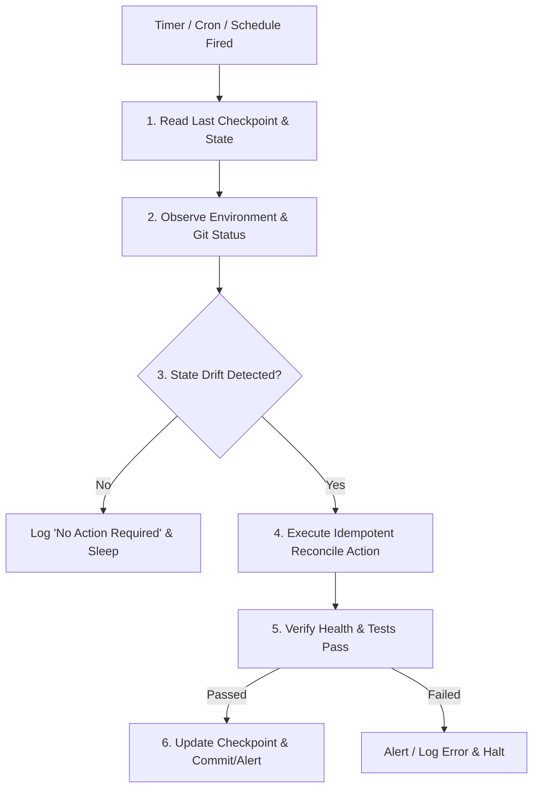

# Schedule-Loop: Idempotent Periodic Reconciliation Pattern

## Intent
Establish an autonomous recurring execution loop (via cron, timers, or daemon schedulers) that periodically audits the repository, reconciles state drift, updates dependencies, runs smoke tests, or triages incoming issues without manual triggering.

## Theoretical Foundation
Inspired by the **Kubernetes Control Loop (Reconciliation Pattern)**: *Observe Current State $\to$ Compare with Desired State $\to$ Reconcile Differences*. To run safely unattended, loops must be **strictly idempotent**: executing 10 times consecutively must yield the exact same end state as executing once.

## Core Operational Principles

1. **Strict Idempotency**: Every operation must verify whether changes are actually required before modifying files or creating commits.
2. **Deterministic Timeouts & Jitter**: Avoid synchronous polling; use native scheduling tools (e.g. Antigravity `schedule`, cron, or GitHub Actions scheduled workflows) with jitter to prevent thunderous herds.
3. **Failure Isolation & Non-blocking**: A failure in one recurring check must log an alert and terminate cleanly without locking files or hanging background processes.
4. **State Checkpointing**: Store last-run timestamps, commit hashes, or state tokens in a lightweight persistent file (e.g. `.agent-state.json`).

## Operational Workflow

### Step 1: Trigger Configuration
Configure the recurring schedule using the target environment's native scheduler:
- In Antigravity: `schedule` tool with `CronExpression` or `DurationSeconds`.
- In CI/CD: GitHub Actions `.github/workflows/reconcile.yml` on `schedule: - cron: '0 */6 * * *'`.
- In CLI / Daemons: Systemd timer, launchd, or background shell loop with graceful signals.

### Step 2: Observation & Diff
- Check git remote for upstream updates (`git fetch`).
- Run security audit (`npm audit`, `pip-audit`, `cargo audit`).
- Check test health or lint cleanliness.

### Step 3: Reconcile & Report
- Apply fixes or updates if drift is found.
- If changes are made, run tests to verify zero regressions.
- If verified, write an atomic commit or open a draft PR.
- Record execution summary and timestamp in `.agent-state.json`.
