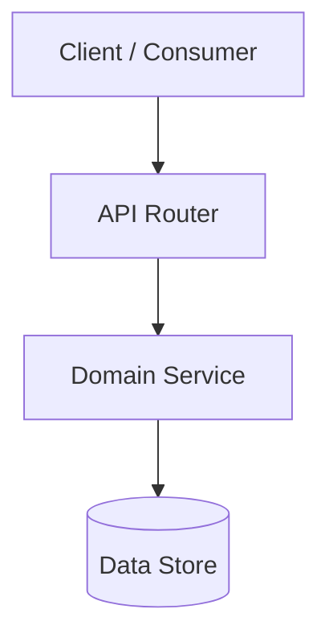

# [RFC / PRD] Feature Name

## Metadata
- **Feature Name**: `[Feature Name]`
- **Author**: `[Author / Agent]`
- **Status**: `Draft` | `In Review` | `Approved` | `Superseded`
- **Created**: `YYYY-MM-DD`
- **Target Release**: `vX.Y.Z`

---

## 1. Problem Statement & Context
*Provide a concise summary of the user problem, technical bottleneck, or system limitation being solved. Reference user feedback, telemetry, or architectural debt where applicable.*

## 2. Goals & Non-Goals
### Goals
- [ ] Explicit, verifiable outcome 1.
- [ ] Explicit, verifiable outcome 2.

### Non-Goals (Strict Out-of-Scope)
- What this feature explicitly **will not** do in this iteration.
- Prevents scope creep and unbounded agent exploration.

## 3. Normative Requirements (RFC 2119)
- The system **MUST** ...
- The system **SHOULD** ...
- The system **MAY** ...
- The system **MUST NOT** ...

## 4. Architecture & Component Design
*Describe the high-level architecture and component boundaries.*



### Affected Files & Boundaries
| File Path | Action | Description of Change |
| :--- | :--- | :--- |
| `src/core/service.py` | Create | New domain service implementation |
| `src/api/routes.py` | Modify | Mount new endpoint handlers |
| `tests/test_service.py` | Create | Comprehensive unit and regression test suite |

## 5. Data Contracts & Interfaces
```typescript
export interface RequestPayload {
  id: string;
  query: string;
  options?: Record<string, unknown>;
}

export interface ResponsePayload {
  success: boolean;
  result: unknown;
  latencyMs: number;
}
```

## 6. Invariants & Security Boundaries
- **Idempotency**: Repeated execution with identical payload must yield identical outcome.
- **Data Validation**: Strict boundary validation on all external inputs before processing.
- **Permissions**: Verify authentication context before invoking domain actions.

## 7. Failure Modes & Rollback Strategy
- **Downstream Outage**: How the system behaves if the primary data store is unavailable.
- **Rollback Procedure**: Exact steps (git revert, schema rollback, feature flag toggle) to restore prior state.
